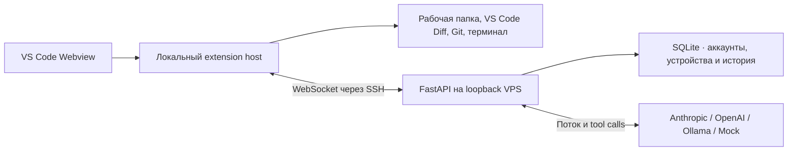

# Архитектура Claude Bridge

Webview рисует чат и отправляет намерения локальному extension host. Расширение хранит токен в SecretStorage и авторизуется через HTTP-заголовок при WebSocket handshake. Токен привязан к адресу и выбранным настройкам SSH. Для внешнего TLS endpoint допускается `wss://` с обычной проверкой сертификата. Для туннеля используется loopback `ws://` и OpenSSH со строгой проверкой ключа хоста.

Backend изолирует диалоги по аккаунту, а активный вызов инструмента — по соединению, диалогу и ID вызова. Устройства одного аккаунта получают уведомления об изменениях истории. Одна генерация выполняется на соединение и на диалог. Запрос, прерванный потерей связи, можно запустить вручную после сверки уже применённых изменений.

FastAPI валидирует входящие сообщения Pydantic. Остальная проверка включает лимит кадра 128 КБ, 12 промптов и 120 handshake в минуту, 120 сообщений на устройство за 20 секунд, до 32 соединений и 12 одновременных диалогов в одном процессе. Одному запросу доступно до восьми вызовов инструментов, до 180 секунд ожидания результата и до 10 минут работы. SQLite хранит до 100 диалогов аккаунта и до 100 завершённых пар в каждом диалоге. База ограничена 32 768 страницами SQLite.

Контекст для модели собирается из последних полных пар сообщений, текущего запроса, вложений и результатов вызовов. `BRIDGE_CONTEXT_BYTES` задаёт верхнюю границу размера этой части контекста в байтах UTF-8. Это консервативная оценка; доступное окно и токенизация зависят от выбранной модели. При исчерпании бюджета агент возвращает ошибку с предложением разбить задачу. Протокол на клиенте и API провайдеров идёт потоком. Отмена закрывает провайдерский поток и отменяет ожидание локального инструмента.

SQLite сохраняет текст завершённых запросов и ответов для синхронизации, а также хеши случайных токенов. Вложения и сетевые результаты инструментов обрабатываются в памяти. Фрагменты, процитированные в синхронизируемом запросе или ответе, сохраняются с ним. Провайдер модели получает контекст текущего запроса; для внешнего API применяются его условия обработки данных. Папка проекта, Git и команды остаются на компьютере с VS Code.

## Локальные разрешения

- Включение доступа привязывает агентный цикл к выбранной доверенной рабочей папке. Поддерживаются относительные пути, проверка каждого компонента и повторная проверка файлов перед чтением и записью. Ссылки, перенаправления пути, дополнительные жёсткие ссылки и характерные имена секретов блокируются. Ограничены размер чтения и число результатов поиска.
- Для четырёх изменяющих инструментов расширение показывает снимки «до» и «после» в VS Code Diff. Оно проверяет несохранённые буферы и сверяет файл со снимком перед записью. Патч ограничен одним существующим текстовым файлом, применяемым без fuzz. Команда пользователя в терминале может менять проект параллельно, поэтому не запускайте сторонние массовые операции во время применения Diff.
- Для `run_command` отображаются точная команда и рабочая папка. После подтверждения команда запускается с правами текущего пользователя. Рабочая папка задаёт стартовый каталог процесса. Команды могут обращаться к тому, что доступно вашему пользователю, и их нужно проверять целиком перед подтверждением. Сеанс терминала неинтерактивный, сохраняет вывод для просмотра, ограничен 90 секундами и поддерживает остановку.
- Вложения и результаты инструментов маркируются как недоверенный контекст. Для отображения Markdown выключен исходный HTML, запрещены изображения, включена очистка допустимого HTML и используется Content Security Policy. Открытие ссылки требует отдельного согласия.
- Сканер секретов использует шаблоны имён и содержимого и может как пропускать непредусмотренные форматы, так и блокировать безобидные строки. Подтверждение действий и выбранная область доступа работают независимо от ответов модели. Конкурентные изменения дерева файлов другим локальным процессом нельзя надёжно изолировать пользовательскими проверками пути на всех целевых ОС.

## Компоненты

| Путь | Назначение |
| --- | --- |
| `extension/src/extension.ts` | Команды VS Code, сессии, контекст и подтверждения |
| `extension/src/workspace.ts` | Проверка путей, безопасное чтение и поиск |
| `extension/src/localTools.ts` | Инструменты, проверка аргументов и Diff |
| `extension/src/transport.ts` | WebSocket, восстановление и запуск OpenSSH |
| `extension/src/webview.ts` | UI, Markdown, подсветка |
| `backend/bridge/app.py` | WebSocket, авторизация, лимиты и агентный цикл |
| `backend/bridge/providers.py` | Абстракция модели и адаптеры SSE |
| `backend/bridge/store.py` | SQLite, диалоги и ключи устройств |
| `deploy/` | Установка, обновление и service unit |
